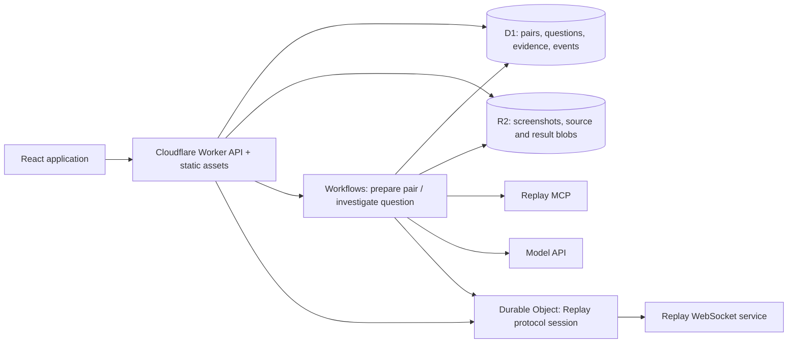

# Full-stack Replay demo: research and implementation plan

Drafted November 6, 2026. This document proposes implementation decisions; API capabilities cited below are documented, but have not yet been validated against a real paired recording.

## 1. Product and scope

Build a browser application that turns separate frontend and backend recordings into one navigable investigation workspace. Its backend runs on Cloudflare. Replay remains the external service that processes and inspects the recordings.

The startup screen is a table of known paired recordings, not a single hardcoded demo. Each row shows name, application, frontend/backend recording identifiers, captured date, duration, readiness, stitching quality, question count, and last investigation time. Selecting a row opens that pair's saved screenshot timeline and questions. Provide search, sorting, a return-to-library link, and stable URLs.

For the first version, populate the table from a versioned manifest imported into the database. Adding pairs must be a data operation with no UI code changes. An import form is optional after the core experience works. The schema should allow one frontend and several backend recordings, while the initial interface can require one of each.

Required experience:

1. Select a known pair.
2. Browse the frontend screenshots using a filmstrip and scrubber.
3. Ask a question beneath the timeline. Search scope defaults to the whole pair; the current point supplies context rather than an implicit time restriction.
4. See all prior questions below the composer, with status and answer previews.
5. Select a question to see its agent investigation conversation and its annotated timeline.
6. Select an annotated execution point to inspect the recorded source, stack, and variables, whether the point belongs to the frontend or backend.
7. Reload or return later without losing questions, evidence, or timeline selection links.

Initial exclusions: recording capture inside this app, production instrumentation installation, arbitrary backend languages, a full replacement for Replay DevTools, collaboration/presence, and automatic code repair. Backend support is capability-driven, not inferred merely from the presence of a backend recording ID.

## 2. Research findings and feasibility gates

| Finding | Architectural consequence |
| --- | --- |
| Replay exposes Streamable HTTP MCP, a WebSocket inspection protocol, and a metadata GraphQL API. | Use MCP for agent tools and structured protocol responses for the debugger. GraphQL is not the recording-content API. [Replay APIs](https://docs.replay.io/reference/replay-apis) |
| MCP provides screenshots, network investigation, source search, point descriptions, stacks, and evaluation. | Reuse these investigation capabilities rather than implement a new analysis engine. [MCP tools](https://docs.replay.io/reference/replay-mcp/tools) |
| Graphics exposes paint enumeration and screenshot retrieval at paint points. | Store screenshot time and paint identity separately from code execution points. [Graphics protocol](https://static.replay.io/protocol/tot/Graphics/) |
| Sessions can create and release pauses; Pause exposes frames, scopes, and object inspection. | A custom debugger is feasible, subject to a live contract test for each supported runtime. [Session](https://static.replay.io/protocol/tot/Session/), [Pause](https://static.replay.io/protocol/tot/Pause/) |
| Public Replay Node documentation describes a Node 16 alpha that is not under active development. | Existing backend recordings or a newer internal recording path must be tested. Do not assume arbitrary current Node or Cloudflare Workers recordings work. [Replay Node](https://docs.replay.io/reference/replay-runtimes/replay-node) |
| A cold MCP RecordingOverview can take three to four minutes. | Preparation must be asynchronous, visible, and reusable across questions. [MCP tools](https://docs.replay.io/reference/replay-mcp/tools) |

There is no verified automatic cross-recording stitching contract in the sources examined. Implement stitching behind an adapter, and first check whether the actual backend recordings already expose request correlation or parent recording metadata. The connected tool definitions mention backend function analysis in network request detail, but that alone does not establish that independent recording IDs are linked.

First feasibility gate: on at least two real pairs, prove screenshot discovery, frontend and backend point inspection, source/stack/scope retrieval, and at least one unambiguous cross-recording request link. One pair must contain overlapping or repeated requests. Also prove that MCP point references can be resolved into stable protocol execution points. References such as `Point:42` must not be assumed globally stable or directly usable after a session restarts.

The protocol reference includes older introductory language about authentication; follow the current API authentication documentation and validate the live handshake. Pin protocol types and isolate version differences in the adapter.

## 3. Screen layout and navigation

```text
Recording library → Selected pair                               Back to library
┌────────────────────────────────────────────────────────────────────────────┐
│ Pair name · frontend/backend readiness · correlation quality               │
│ Large screenshot preview                     selected time + playback     │
│ Screenshot filmstrip and global time ruler                                │
│ Frontend lane     ●──────────●────────────────────────●                     │
│ Backend lane           ●────────●                                          │
│ Selected question     labelled points and causal request connectors        │
├────────────────────────────────────────────────────────────────────────────┤
│ Ask about this recording…             Context: 00:12.340 · frontend         │
├───────────────────────────────────┬────────────────────────────────────────┤
│ All questions                     │ Selected question                      │
│ Why did the total change?         │ Answer + cited evidence                 │
│ Why was the request slow?         │ Agent messages and tool activity        │
│ …                                 │ Expandable tool inputs/results          │
└───────────────────────────────────┴────────────────────────────────────────┘
Selected point → resizable inspector: source | call stack | scope/value tree
```

Keep the filmstrip visible when the inspector opens. Selecting a backend point shows the corresponding frontend screenshot with an explicit temporal relationship label, not an assertion that the backend had a screen. Use the last known frontend screenshot at or before mapped time; show its actual timestamp and a gap indicator. If alignment is unknown, retain the previous image with an “unmapped backend point” label.

Question selection changes the annotation overlay, not the underlying recording. Preserve the current cursor unless the user clicks a marker or chooses “jump to question context.” Show a compact question timeline even if it has only two points; when no relevant points have been found, show that state explicitly. Offer “Generate timeline” for a completed answer without one, and “Update timeline” as a new revision.

Markers have runtime, short description, event type, exact point identity, supporting evidence, and correlation confidence. Use text and shapes as well as color. Cluster overlapping markers and provide a chronological list alternative. Clicking a transcript citation and clicking its timeline marker produce the same selection.

Deep links encode pair, question, timeline revision, and stable point ID. Keep a screen-time cursor distinct from a selected execution point; arbitrary scrub positions do not necessarily have a meaningful paused JS frame. On an unmapped screenshot, offer nearby inspectable events rather than invent a point.

## 4. Stitching independent recordings

Treat stitching as a causal graph plus a display-time mapping. Never merge execution-point strings or claim that equal timestamps represent the same execution.

Canonical identity:

```ts
type PointRef = {
  recordingId: string;
  executionPoint: string; // Opaque, lossless; never a JS number
};

type TimelineMarker = {
  id: string;
  questionId: string;
  timelineRevision: number;
  point: PointRef;
  localTimeMs: number;
  displayTimeMs?: number;
  label: string;
  evidenceIds: string[];
};
```

Keep runtime identity on recording records, and preserve source IDs, generated and mapped locations, native ordering metadata, and original timestamps. Multiple execution points may share a screenshot timestamp. Pause/frame/object handles are ephemeral and session-scoped; they are not permanent IDs.

Correlation hierarchy:

1. Match explicit request/trace/span metadata recorded at both ends. Use a per-request identifier, not trace ID alone: several requests may share a trace. The W3C trace context standard provides interoperable propagation fields; actual availability must be inspected. [Trace Context](https://www.w3.org/TR/trace-context/)
2. For controlled future capture, propagate a unique request ID or standard trace context and record server receipt/completion with execution points. Include retry/attempt identity and handle CORS where custom headers are used.
3. For existing recordings without IDs, propose matches from method, normalized URL, payload signature where permitted, status, order, and timing constraints. Label these inferred and preserve alternatives.
4. Permit explicit manual mapping in the pair manifest. Unmatched requests remain unmatched; do not silently select the nearest same-URL request.

Each edge records frontend request identity, backend request identity, endpoints, evidence, method (`explicit`, `manual`, `inferred`), and confidence. Retries, redirects, fan-out, and responses are separate edges/events. A backend recording serving multiple clients must be filtered by causal membership; unrelated work can appear as dim background context rather than as part of the answer.

For visualization use `displayTime = scale * localTime + offset` per recording, with frontend time as the display origin. A shared timestamp origin is a useful initial estimate, not proof of causation. With frontend send/receive times `f_send`, `f_recv` and server receive/send times `b_recv`, `b_send`, an offset-only model requires:

```text
f_send - b_recv <= offset <= f_recv - b_send
```

Use multiple linked requests to constrain offset; do not equate send and receive instants because transit takes time. Fit drift only when enough independent anchors justify it. Store uncertainty intervals, residuals, anchor provenance, and mapping revision. When bounds conflict, flag the mapping instead of distorting local ordering. Render uncertain ordering honestly; causal edges can remain valid when exact cross-runtime timing is unknown.

Question context and published timelines retain their stitching revision. Re-indexing creates a new revision; old answers remain reproducible.

## 5. Cloudflare architecture

Use TypeScript throughout. Proposed UI: React + Vite, a read-only CodeMirror source pane, query caching, and virtualized screenshot/question lists. Confirm package versions at implementation time. Use SVG/HTML timeline lanes initially; canvas is unnecessary for the bounded demo.



| Component | Ownership and purpose |
| --- | --- |
| Worker + static assets | Serve UI and authenticated APIs; validate pair membership; proxy private artifacts. [Static assets](https://developers.cloudflare.com/workers/static-assets/) |
| D1 | Authoritative registry, questions, run status, append-only public conversation events, evidence references, timeline revisions, and correlation mappings. [D1](https://developers.cloudflare.com/d1/) |
| R2 | Private screenshots/thumbnails, immutable source blobs, and large tool-result payloads. Store pointers in D1. Raw recordings stay with Replay. [R2](https://developers.cloudflare.com/r2/) |
| Workflows | Durable preparation and bounded investigation steps independent of an open browser tab. Persist results and make retries idempotent. [Workflow rules](https://developers.cloudflare.com/workflows/build/rules-of-workflows/) |
| Protocol-session Durable Objects | Own outbound Replay sockets, request IDs, session lifecycle, bounded pause cache, and reconnects. Key by access scope and recording. [Durable Object WebSockets](https://developers.cloudflare.com/durable-objects/best-practices/websockets/) |

For the demo, poll durable event rows using `afterSequence` while a run is active. This keeps one source of truth and makes reconnect reliable. Add push delivery later if token-by-token streaming proves important; do not make a live socket the only record of progress. Show assistant messages and tool progress as they are persisted.

Outgoing WebSockets do not hibernate. Close idle Replay sessions, release pauses, and restore sessions on demand. Do not promise that a warm object or socket survives a deployment. [WebSocket lifecycle](https://developers.cloudflare.com/durable-objects/best-practices/websockets/)

Keep thumbnail transfer and large artifacts streamed; avoid loading whole recordings or large object graphs into Worker memory. Workers have a documented 128 MB isolate limit, and background `waitUntil` is not a durable job runner. [Workers limits](https://developers.cloudflare.com/workers/platform/limits/)

No container is required for this architecture: Cloudflare executes the application and orchestration, while Replay executes time-travel inspection. If a chosen SDK needs unsupported Node facilities, implement its HTTP/WebSocket transport using web APIs before adding infrastructure.

## 6. Persistent model and API contracts

Suggested D1 entities:

- `recording_pairs`: identity, label, application, ownership/access scope, readiness, active index revision.
- `recordings` and `pair_recordings`: Replay ID, runtime, build/source metadata, capabilities, pair role.
- `index_revisions`, `screenshots`, `request_events`, `correlation_edges`, `time_mappings`: normalized preparation results and provenance.
- `questions`: pair ID, text, immutable submitted context (cursor, selected point, screenshot, mapping revision), creation time.
- `investigation_runs`: question ID, attempt, model/tool versions, status, budget, workflow ID, cancellation generation.
- `conversation_events`: run ID, monotonic sequence, event type, message/tool IDs, content or blob reference.
- `evidence`: recording/point/source references and originating tool call.
- `timeline_revisions`, `timeline_markers`: question-scoped, validated annotations and evidence links.

Indexes should support pair listing, questions by pair, events by run/sequence, markers by question/revision, and events/screenshots by recording/time. Use unique idempotency keys for question submission and logical workflow step events. Scope every query and artifact authorization to the pair; UUID obscurity is not access control.

Proposed routes:

```text
GET  /api/pairs
GET  /api/pairs/:pairId
POST /api/pairs/:pairId/prepare
GET  /api/pairs/:pairId/timeline?from=&to=&resolution=
GET  /api/pairs/:pairId/questions
POST /api/pairs/:pairId/questions             {text, context, idempotencyKey}
GET  /api/questions/:questionId
GET  /api/runs/:runId/events?afterSequence=
POST /api/runs/:runId/cancel
POST /api/questions/:questionId/timelines     {runId}
POST /api/pairs/:pairId/inspect               {point, frameSelection?}
POST /api/pairs/:pairId/objects               {inspectionToken, object, cursor?}
GET  /api/artifacts/:artifactId
```

The public inspection token wraps short-lived session handles. On expiry, reopen the stable point and selected frame before expanding values. Never serve a cached object handle from another pause or user.

## 7. Agent investigation workflow

At submission, freeze the question context and return a durable question/run ID immediately. A cursor move afterward must not alter the question. Supply the agent with both recording identities, capability summaries, the current point/screenshot, stitching quality, and the whole-pair event overview.

The agent then:

1. Reviews recording summaries and relevant frontend events.
2. Finds requests or source locations explaining the visible symptom.
3. Follows supported correlation edges into backend execution, querying the backend recording explicitly.
4. Inspects relevant values and stacks, then follows the result back to frontend state/rendering.
5. Publishes a concise answer with evidence citations and a small ordered set of timeline markers.

Expose a readable investigation conversation: assistant progress summaries, tool names and arguments, tool results, evidence discoveries, failures, and the final answer. This is observable agent activity, not hidden model reasoning. Persist original authorized tool results separately from their concise UI summaries.

Use a model-independent tool-calling adapter; provider/model choice is an implementation setting. Expose an allowlisted Replay tool set plus application tools such as `followRequest`, `inspectPoint`, and `publishTimeline`. Avoid granting a general shell. Treat source code, logs, and recorded page content as untrusted data.

`publishTimeline` accepts structured markers. Validate pair membership, resolvable exact points, evidence IDs, labels, and mapping revision on the server. Reject fabricated or unresolved points; the agent can still publish an answer with an explicit evidence gap. A useful target is 4–10 significant markers rather than every tool call.

Bound runs initially to a configurable tool-call count, token budget, and wall-clock duration; measure rather than promise a fixed answer time. Persist each completed model turn and tool result in separately retryable steps. Use deterministic logical call IDs to deduplicate event writes. A timeout can still leave an upstream call running, so track uncertain attempts; do not claim exactly-once external execution or billing. Cancellation stops new work and ignores late results using a run generation check.

## 8. Source, stack, and variable inspector

Resolve the stable point to a pause, retrieve frames, select the top application frame, and fetch its recorded source and scopes. Use recorded/source-mapped code, not the current repository checkout. The Debugger protocol exposes source contents and mapped locations. [Debugger protocol](https://static.replay.io/protocol/tot/Debugger/)

Show arguments, locals, closure scopes, globals, `this`, and exception state where available. Changing frames updates source and scope values. Expand objects lazily, with bounded previews and explicit continuation where the provider supports it. Preserve representations of `undefined`, NaN, BigInt, cycles, functions, and unavailable values. Do not invoke getters automatically. The Pause domain distinguishes object previews/properties from effectful evaluation. [Pause protocol](https://static.replay.io/protocol/tot/Pause/)

Interpret “all variable values” as access to every inspectable binding across the available stack/scopes, with expandable values. Eagerly materializing the entire heap is neither practical nor guaranteed by the protocol. Explicitly display missing/optimized-out/unavailable state and unsupported expansions; never substitute an empty object or invented value. Validate coverage in the first feasibility gate and expose any runtime limitations.

Rapid clicking must cancel or supersede UI requests; late results cannot overwrite the selected point. Cache source by recording/source identity and inspection data by recording/point/frame with appropriate access scope. Release unused pauses and cap concurrent sessions.

## 9. Preparation, performance, and operational behavior

Opening a pair starts or resumes preparation: authenticate recordings, discover capabilities, index screenshot timestamps and event metadata, identify correlations, then produce thumbnail assets and summaries. Show per-recording progress and partial readiness. Basic screenshot browsing should not wait for all agent analysis.

Fetch thumbnails in viewport-sized batches and load a larger image only for the selected screenshot. Keep full-resolution images out of list payloads. Prewarm selected sample pairs before a demo, while leaving cold-loading behavior honest. Use content/version keys so reprocessing does not overwrite evidence used by old answers.

Proposed acceptance targets, to measure on a defined demo laptop/network: under 2 seconds to open a prepared pair's filmstrip, under 150 ms for cached screenshot selection, and under 500 ms for cached point inspection. Cold Replay calls may take materially longer; display ongoing progress, elapsed time, retry, and cancellation. These are targets, not measured claims.

Protect the private demo with authenticated access, keep Replay/model keys in Worker secrets, authorize all pair and blob access server-side, and sanitize rendered Markdown. Avoid logging recorded tokens or full variable payloads. Use synthetic/non-sensitive examples for publicly shared demos. Record preparation latency, tool latency, cache hits, run cost, reconnects, correlation coverage, and failed point resolutions.

## 10. Implementation order and exit criteria

| Milestone | Work | Exit criterion |
| --- | --- | --- |
| 0. Real-data compatibility spike | Test two recording pairs; verify runtime capabilities, point-reference resolution, sources/scopes, screenshots, correlation, and Cloudflare transport. | Both sides of one real request can be inspected through the proposed adapter. Record unresolved capability gaps explicitly. |
| 1. Repository and library | Set up React/Worker project, D1 migrations, R2 bindings, manifest import, authentication, and pair list/detail routes. | Two pairs load independently and survive refresh; wrong-pair access is rejected. |
| 2. Recording timeline | Preparation Workflow, screenshot indexing/cache, filmstrip, time cursor, event lanes, correlation data and uncertainty. | Navigate both pairs with sparse screenshots, repeated requests, and incomplete mappings handled correctly. |
| 3. Point inspector | Protocol Durable Object, source/stack/scope adapter, lazy values, reconnect and pause lifecycle. | Inspect verified frontend and backend points and switch stack frames without stale data. |
| 4. Questions and investigations | Persist questions/context, run Workflow, tool adapter, public event transcript, cancellation and resume. | A question continues after browser close; reopening shows the correct persisted conversation. |
| 5. Question timelines | Validated marker publishing, question selection, evidence links, deep links, timeline revisions. | A live answer produces clickable markers spanning both recordings, each opening the correct source and values. |
| 6. Demo hardening | Multi-pair acceptance suite, retries, cold states, limits, performance, deployed Cloudflare smoke test. | Complete the scripted demo on at least two real pairs, including an unseen question. |

Build the first real vertical slice before polishing all views: pair → screenshot → question → cross-recording evidence → clickable backend point. Do not let a canned transcript or fixture-only backend satisfy the completion criteria. Fixtures are useful for deterministic development and failure tests, but clearly labelled fixture mode is separate from live investigation.

Proposed repository layout:

```text
apps/web/                  React UI
apps/worker/               HTTP API, Workflows, protocol Durable Object
packages/domain/           schemas, point identities, stitching, event contracts
packages/replay/           MCP/protocol adapters and capability detection
migrations/                D1 schema
fixtures/                  sanitized adapter responses and pair manifests
tests/                     contract, integration, and browser acceptance tests
docs/                      plan, decisions, demo runbook
wrangler.jsonc             added when implementation begins
```

Use unit/property tests for identity and mapping invariants, adapter contract tests for runtime data, Worker integration tests for durable/idempotent state, and browser tests for the complete user journey. Essential adversarial cases: same URL concurrent requests, retries, clock skew, no correlation headers, backend unrelated traffic, sparse screenshots, unavailable source maps, expired pauses, duplicate Workflow delivery, tool timeout, disconnect/reload, cancellation, and switching pairs during a running investigation.

## 11. Remaining inputs and decisions

The startup registry and per-pair question organization are confirmed by the user. Implementation still needs actual paired recording IDs and authorized access, a verified backend recording/runtime path, model credentials, and a Cloudflare deployment target. None is needed to complete this plan; all are needed to validate live end-to-end behavior.

Default decisions: support multiple pairs immediately; keep question context immutable; preserve exact per-recording execution identities; label inferred stitching; use Cloudflare for all application persistence/orchestration; retain Replay as the inspection service; start with durable event polling and add push only if needed. Revisit these after the compatibility spike, based on measured data rather than assumptions.
